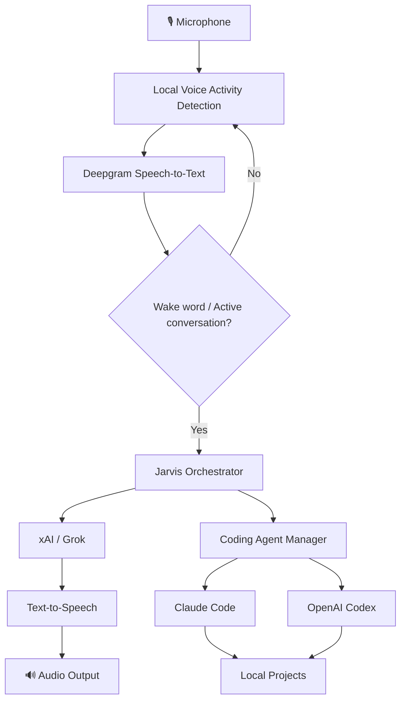
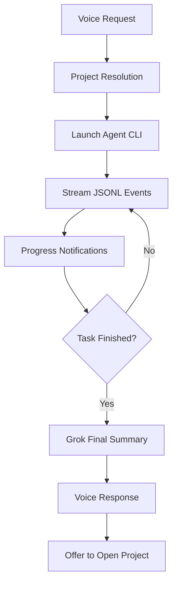

# ◉ JARVIS

### Your desktop. Your voice. Your AI.

**An intelligent, voice-first desktop assistant built with Rust and Tauri 2.**

Talk naturally. Automate your workflow. Build software with AI agents. All from a minimal, floating interface that stays out of your way.

**Rust** · **Tauri 2** · **Deepgram** · **xAI / Grok** · **Claude Code** · **OpenAI Codex**

---

<p align="center">


</p>

> **"Jarvis, crea una aplicación."**
>
> One sentence. An AI-powered development workflow.

Jarvis brings real-time voice interaction, AI reasoning, and autonomous coding agents into a lightweight desktop experience. No browser tabs, no complex dashboards, and no frontend build pipeline.

Designed for natural Spanish conversations, fast interruptions, and seamless delegation to developer tools.

## ✦ Features

| Feature | Description |
|---|---|
| 🎙️ **Voice-first interaction** | Natural Spanish conversations with wake-word activation. |
| ◉ **Floating interface** | A draggable, minimal sphere that lives on your desktop. |
| ⚡ **Interruptible responses** | Speak while Jarvis is responding to interrupt playback. |
| 🧠 **AI reasoning** | Conversational intelligence powered by xAI / Grok. |
| 💻 **Coding agents** | Delegate software development tasks to Claude Code or Codex. |
| 🔄 **Project continuity** | Resume agent sessions within the same project. |
| 🔐 **Secure credentials** | Store API keys in the operating system's native keyring when available. |
| 🛠️ **Live configuration** | Automatically reload valid configuration changes. |
| 🖥️ **Cross-platform** | Native desktop builds for Windows, macOS, and Linux. |
| 🧪 **Offline testing** | Test the application without external API keys or services. |

## ◉ The Experience

**Minimal by design. Powerful by voice.**

Jarvis is built around a floating desktop sphere rather than a traditional application window.

- **Drag** the sphere anywhere on your desktop.
- **Hover** to reveal the settings icon.
- **Double-click** to hide the window.
- **Open from the system tray** whenever you need it.
- **Press Escape** to close the settings panel.
- **Mute or unmute** the microphone with a global shortcut.

| Platform | Microphone shortcut |
|---|---|
| Windows / Linux | `Ctrl + Shift + J` |
| macOS | `Cmd + Shift + J` |

### Natural conversation

Start by saying:

> **You:** Jarvis, hola.
>
> **Jarvis:** [Responds through the configured voice system.]
>
> **You:** Ahora ayúdame a crear un proyecto.

After Jarvis responds, you have a **20-second follow-up window** to continue the conversation without repeating the wake word.

On subsequent launches, Jarvis can listen from the system tray without playing an initial greeting.

## 🚀 Getting Started

### 01 — Install Jarvis

Install the package appropriate for your operating system.

| Operating system | Package formats |
|---|---|
| Windows | `.exe` (NSIS), `.msi` |
| macOS | `.app`, `.dmg` |
| Linux | `.AppImage`, `.deb` |

Packages are generated by the build workflow. They are not automatically published as GitHub Releases.

### 02 — Configure your API keys

On the first launch, Jarvis opens the settings panel.

You'll need:

1. **Deepgram API key** — speech recognition.
2. **xAI API key** — conversational intelligence.

Obtain credentials from:

- [Deepgram Console](https://console.deepgram.com/)
- [xAI Console](https://console.x.ai/)

Enter both keys and select **Guardar**.

Jarvis validates the credentials, stores them securely, and activates the microphone.

If one validation fails, the valid credential remains temporarily in memory while you correct the other.

### 03 — Start talking

Say:

```text
Jarvis, hola.
```

That's it. Jarvis is ready to assist.

## 🧠 How Jarvis Works

Jarvis combines local audio processing with cloud-based AI services and optional local coding agents.



### Technology stack

| Layer | Technology |
|---|---|
| Desktop framework | Tauri 2 |
| Core runtime | Rust |
| User interface | HTML, CSS, vanilla JavaScript |
| Speech recognition | Deepgram |
| Conversational AI | xAI / Grok |
| Coding automation | Claude Code / OpenAI Codex |
| Configuration | TOML |
| Credential storage | Native keyring / restricted fallback |
| Audio output | Web Audio |

**No React. No frontend bundler. No npm runtime dependency.**

Node.js is only used for development tests.

## 💻 AI Coding Agents

### From an idea to a working project

Jarvis can delegate programming tasks to locally installed AI coding agents.

Try commands like:

```text
"Jarvis, crea una aplicación de tareas en Rust."

"Jarvis, cómo va el proyecto."

"Jarvis, continúa con la implementación."

"Jarvis, cancela eso."
```

The agent runs in the background while Jarvis manages the conversation.

### Supported agents

| Agent | Integration | Permission policy |
|---|---|---|
| Claude Code | Local CLI | `acceptEdits` |
| OpenAI Codex | Local CLI | `workspace-write` |

Both tools must be **installed and authenticated independently**.

The Deepgram and xAI API keys do not authenticate either coding agent.

If an agent is unavailable, Jarvis explains the problem through voice.

### Project workspace

Projects are organized under:

```text
~/Jarvis/
└── projects/
    ├── my-first-app/
    ├── rust-backend/
    └── desktop-tool/
```

Jarvis normalizes project names, canonicalizes working paths, and verifies that the resulting working directory remains inside the project root.

**Important:** This is a working-directory restriction, not an operating-system sandbox. External agents may still have access to resources permitted by their own execution environment.

### Agent execution lifecycle



Jarvis supports:

- Session continuity per project during the current application run.
- Background execution without blocking the interface.
- Streaming progress through JSONL events.
- Process-tree cancellation.
- A default execution timeout of **30 minutes**.
- Progress notifications no more frequently than every **12 seconds**.
- Voice notifications that wait until you finish speaking.
- A final summary generated with a single Grok request.
- Voice confirmation before opening the resulting project folder.

Tasks are passed through standard input without interpolating the user's instructions into a shell command.

### Agent permissions

Additional CLI arguments can be configured through `coding.extra_args`.

Arguments that change the working directory or communication protocol are rejected.

For Claude Code, `--dangerously-skip-permissions` is strictly opt-in. It does not turn the project directory into a system sandbox.

Jarvis does not automatically grant permissions outside the selected agent's policy.

## 🛠️ Development

### Prerequisites

Install the latest stable Rust toolchain and the official [Tauri 2 prerequisites](https://v2.tauri.app/start/prerequisites/).

| Platform | Requirements |
|---|---|
| Windows | Visual Studio Build Tools, C++ workload, Windows SDK |
| macOS | Xcode Command Line Tools |
| Linux | WebKitGTK 4.1, AppIndicator, and the libraries specified in the build workflow |

### Run locally

Install the Tauri CLI:

```bash
cargo install tauri-cli --locked --version '^2'
```

Start the development environment:

```bash
cargo tauri dev
```

### Build for production

```bash
cargo tauri build
```

Build outputs are generated in:

```text
target/release/bundle/
```

The GitHub Actions workflow at `.github/workflows/build.yml` builds for Windows, Linux, macOS Apple Silicon, and macOS Intel, and retains the generated artifacts.

Windows packages include WebView2 installation support. The Linux AppImage bundles the required multimedia libraries.

**Distribution note:** Local builds are unsigned. Production signing and Apple notarization require the publisher's certificates and credentials. The workflow does not automatically publish releases.

<details>
<summary><strong>Windows: MinGW development workaround</strong></summary>

On the development machine used for this project, Visual Studio's linker and SDK were unavailable, so MinGW was used instead.

A MinGW installation path containing spaces caused internal failures.

The following environment variables were used locally:

```powershell
$env:PATH = 'C:/mingw64/bin;' + $env:PATH
$env:CARGO_TARGET_DIR = 'C:/tmp/jarvis-target'

cargo tauri dev
cargo tauri build
```

This workaround is specific to that development environment. It is not a general requirement for Jarvis or its installers.

</details>

## ⚙️ Configuration

Jarvis creates two editable configuration files in the platform-specific configuration directory associated with `com.jarvis.voice`.

```text
config.toml
system_prompt.txt
```

Default values are maintained in:

```text
src-tauri/defaults/
```

### Configuration capabilities

| Setting | Purpose |
|---|---|
| Models | Select configured AI models |
| URLs | Configure service endpoints |
| Voice speed | Adjust speech playback speed |
| Language | Configure language behavior |
| Activation | Configure wake-word behavior |
| History | Control conversation history settings |
| Project directory | Set the coding workspace root |
| Keyboard shortcut | Configure microphone activation behavior |
| `tts.transport` | Choose `http` or `websocket` |

Valid changes are reloaded automatically.

An invalid TOML file does not replace the last valid configuration.

### Custom system prompt

Edit `system_prompt.txt` to customize Jarvis's behavior.

Prompt changes are saved after a **600 ms debounce** and take effect on the next conversation turn.

The **Restaurar predeterminado** action restores the original Spanish system prompt.

## 🔐 Security & Privacy

Security is treated as part of the architecture, not merely an interface feature.

### Credential protection

Jarvis uses the operating system's native credential store when available.

If native keyring access is unavailable, it falls back to `credentials.json` with restricted user-only access:

| Platform | Protection |
|---|---|
| Unix | File permissions `0600` |
| Windows | Restricted user ACL |

Stored API keys are never returned to the JavaScript frontend.

Password input fields are cleared after saving.

### Audio and data handling

Jarvis keeps the following application data in memory:

- Conversation state and history.
- PCM audio buffers.
- Active coding-agent session identifiers.

Jarvis does not intentionally persist audio recordings or conversation transcripts to disk.

External coding agents may independently persist their own sessions, logs, or project files according to their configurations.

### Important privacy distinction

Local voice activity detection determines when to connect to Deepgram.

However, wake-word detection operates on transcribed speech. This means audio classified locally as speech can be sent to Deepgram **before** Jarvis has confirmed that you said its name.

Jarvis is therefore not a fully offline voice assistant.

## 🧪 Testing & Validation

Jarvis includes automated tests for its Rust core, audio behavior, network clients, and desktop integration.

### Rust checks

```bash
cargo fmt --all -- --check
cargo check
cargo clippy -- -D warnings
cargo test
```

### Audio tests

```bash
node scripts/test-audio.mjs
node scripts/test-playback.mjs
```

Production clients are tested against local HTTP and WebSocket servers.

The test suite covers incremental responses, optional parameters, incomplete tool calls, PCM alignment, and speech-recognition shutdown behavior.

These tests do not require API keys or contact external providers.

### Native keyring verification

```bash
cargo run --example keyring_probe
```

This probe creates a unique synthetic credential, reads it, and removes it without modifying Jarvis's actual credentials.

## 🧩 Offline Mock Mode

Develop and test Jarvis without cloud credentials or a physical microphone.

**Windows PowerShell**

```powershell
$env:JARVIS_MOCK = '1'
cargo tauri dev
```

**macOS / Linux**

```bash
JARVIS_MOCK=1 cargo tauri dev
```

Mock mode substitutes offline implementations of the STT, LLM, and TTS traits.

It uses a separate `mock/` configuration directory and never reads or modifies the native keyring.

Its synthetic TTS produces a test tone rather than realistic speech.

The test agent writes `demo.txt` and emits JSONL fixtures through the same process manager used by real coding agents.

Mock mode is intended for development and integration testing, not for validating live provider credentials.

### Windows end-to-end smoke tests

Start Jarvis with:

```powershell
$env:JARVIS_MOCK = '1'
$env:WEBVIEW2_ADDITIONAL_BROWSER_ARGUMENTS = '--remote-debugging-port=9222'

cargo tauri dev
```

Then run:

```bash
node scripts/smoke-webview.mjs
```

This checks audio, settings, prompt editing, cancellation, history, tools, and real test-subprocess execution.

For first-run verification:

```bash
node scripts/smoke-first-run.mjs --microphone
```

The first-run test operates without mock mode or saved API credentials. It can optionally inspect 50 frames from a real microphone without sending audio to external providers.

**Never enable the WebView remote-debugging port in a normal production distribution.**

## ⚡ Latency & Diagnostics

Jarvis exposes diagnostic timing information through:

```text
debug_latency
```

The command returns the most recent **20 conversation turns**.

Each turn emits a structured `turn_latency` log entry.

### Timing considerations

| Metric | Interpretation |
|---|---|
| `speech_end` | Timestamp of the last frame classified as speech by local VAD |
| `final_transcript` | Includes endpointing and transport wait time |
| `first_audio_played` | Scheduled Web Audio playback time plus reported output latency |

The VAD uses 20 ms frames, making speech-end estimates sensitive to environmental noise.

Accurate physical acoustic-end measurements require loopback instrumentation.

The default interruption filter requires **200 ms of sustained speech**. Consequently, it cannot guarantee stopping playback within 150 ms of the beginning of that same speech.

For detailed validation methodology and known limitations, see [NOTES.md](NOTES.md).

---

## ✦ Design Philosophy

**Voice should feel like an interface, not a command line.**

Jarvis is built around a few principles:

**Minimal interaction.** A floating sphere should be enough to access a powerful assistant.

**Native performance.** Rust and Tauri provide the foundation without requiring a heavyweight frontend framework.

**Developer-oriented intelligence.** AI should be able to assist with building software, not only answer questions.

**User control.** Credentials, project locations, permissions, and agent execution remain configurable.

**Transparent limitations.** Cloud processing, agent permissions, and audio timing behavior should be documented clearly.

---

<p align="center">

### ◉ JARVIS

**Speak. Think. Build.**

*An intelligent desktop companion, powered by Rust.*

</p>